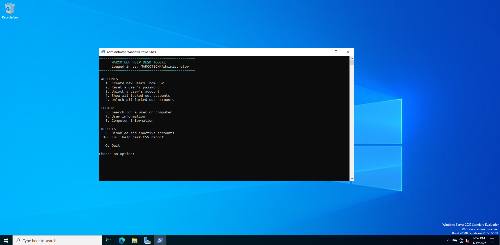
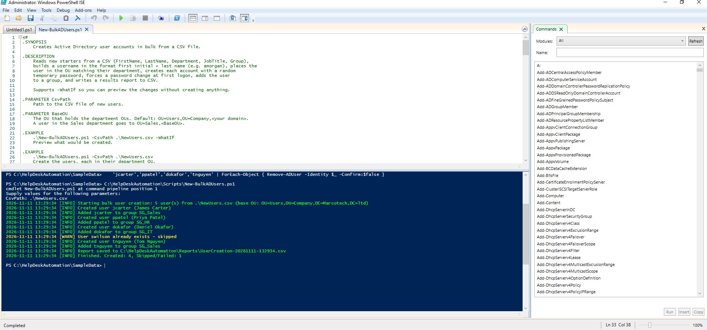
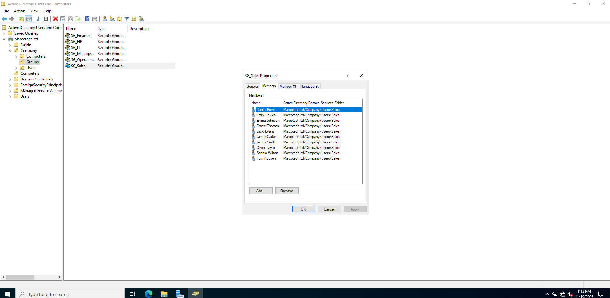
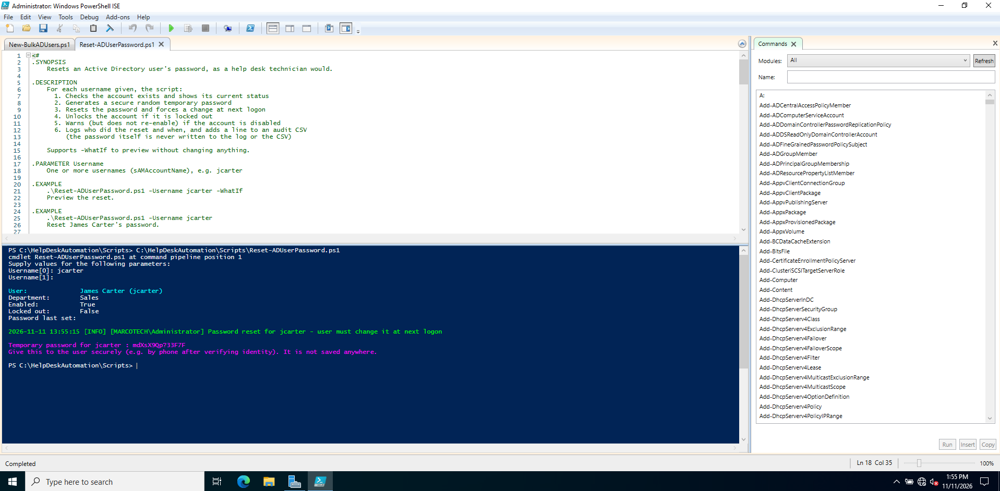
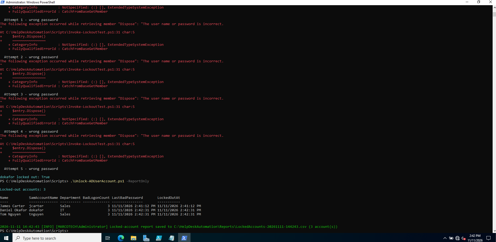
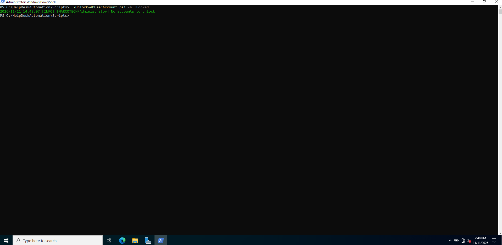
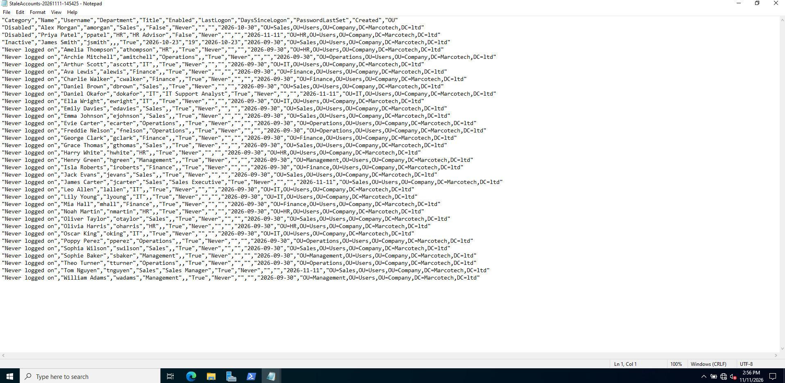
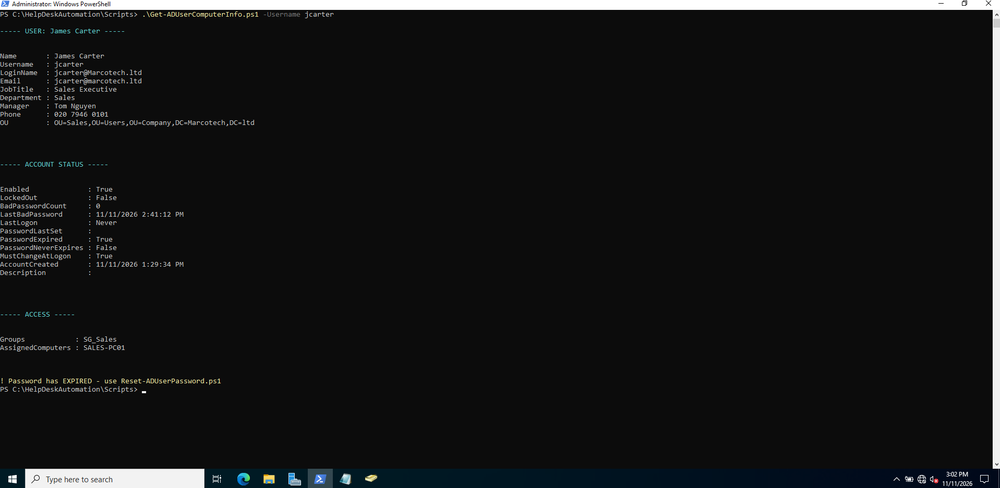
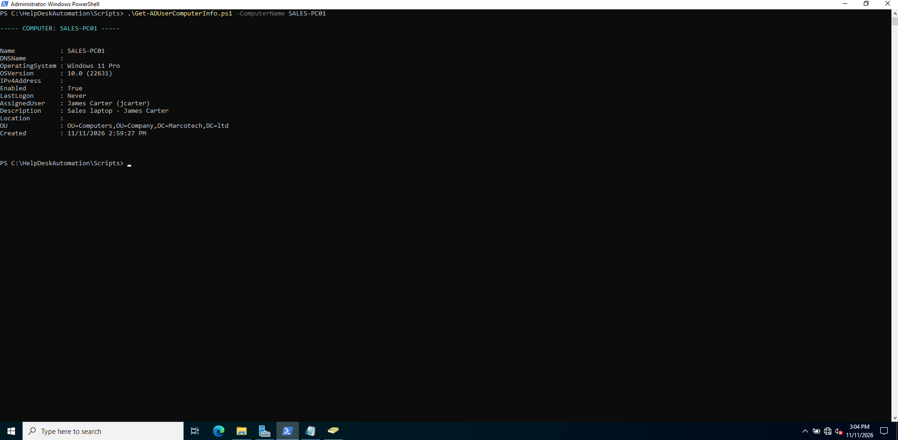
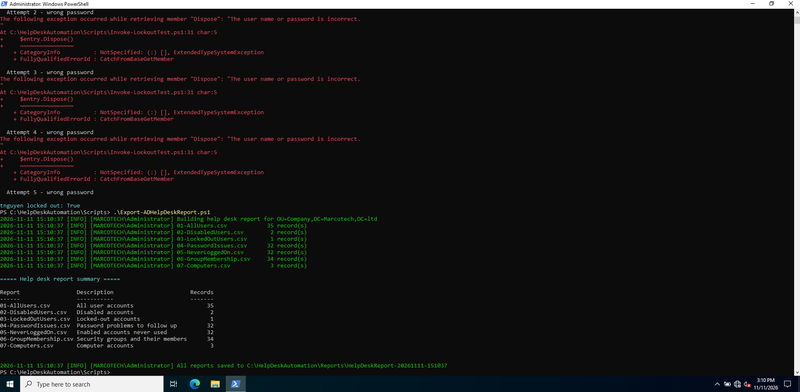

# PowerShell Help Desk Automation

PowerShell scripts that automate common IT help desk tasks in Active Directory: creating users, resetting passwords, unlocking accounts, finding disabled and inactive accounts, looking up users and computers, and producing CSV reports.

Everything was built and tested in a home lab running a Windows Server domain controller for a fictional company, **Marcotech.ltd**.



---

## Why I built this

Most help desk tickets are the same few jobs repeated every day: *"I'm locked out"*, *"I forgot my password"*, *"We have five new starters on Monday"*. Doing them by hand in Active Directory Users and Computers is slow and easy to get wrong. These scripts do each job with one command, check for mistakes, and keep a record of who did what.

## Skills demonstrated

- **Active Directory:** users, OUs, security groups, computer objects, account lockout, Fine-Grained Password Policies
- **PowerShell:** parameters, loops, error handling (`try/catch`), CSV import/export, `-WhatIf` support
- **Help desk process:** checking account status before acting, forcing password changes, handling leavers
- **Security awareness:** temporary passwords never written to logs, audit trail of every change, read-only reporting, stale-account detection
- **Testing and troubleshooting:** found and fixed real problems during testing (see [Challenges](#challenges-and-what-i-learned))

---

## Lab environment

| Component | Details |
|---|---|
| Virtualisation | Oracle VirtualBox |
| Server | Windows Server domain controller (DC01) |
| Domain | `Marcotech.ltd` |
| Tools | PowerShell, PowerShell ISE, ActiveDirectory module |

**AD structure**

```
Marcotech.ltd
└── Company
    ├── Computers      SALES-PC01, SALES-PC02, IT-PC01
    ├── Groups         SG_Finance, SG_HR, SG_IT, SG_Management, SG_Operations, SG_Sales
    └── Users
        ├── Finance
        ├── HR
        ├── IT
        ├── Management
        ├── Operations
        └── Sales
```

---

## The scripts

| Script | What it does | Changes AD? |
|---|---|---|
| [`New-BulkADUsers.ps1`](Scripts/New-BulkADUsers.ps1) | Creates users from a CSV, places them in their department OU, adds them to a security group | Yes |
| [`Reset-ADUserPassword.ps1`](Scripts/Reset-ADUserPassword.ps1) | Resets a password, forces a change at next logon, unlocks if locked | Yes |
| [`Unlock-ADUserAccount.ps1`](Scripts/Unlock-ADUserAccount.ps1) | Finds locked-out accounts and unlocks one, several or all of them | Yes |
| [`Get-StaleADAccounts.ps1`](Scripts/Get-StaleADAccounts.ps1) | Finds disabled, inactive and never-used accounts | No |
| [`Get-ADUserComputerInfo.ps1`](Scripts/Get-ADUserComputerInfo.ps1) | Looks up a user or computer, or searches by name | No |
| [`Export-ADHelpDeskReport.ps1`](Scripts/Export-ADHelpDeskReport.ps1) | Exports a full set of user, group and computer reports to CSV | No |
| [`HelpDeskToolkit.ps1`](Scripts/HelpDeskToolkit.ps1) | Menu that runs all of the above from one place | Via the other scripts |
| [`Invoke-LockoutTest.ps1`](Scripts/Invoke-LockoutTest.ps1) | **Lab only:** locks a test account so the unlock script can be tested | Yes (test accounts) |

### Features shared by all scripts

- **`-WhatIf` support:** scripts that make changes can preview them first without changing anything
- **Logging:** every action is written to a dated log file with a timestamp and the technician's username
- **Error handling:** a wrong username, missing OU or missing group gives a clear message instead of a crash
- **CSV output:** results are saved to the `Reports` folder

---

## 1. Bulk user creation

Reads new starters from [`SampleData/NewUsers.csv`](SampleData/NewUsers.csv):

```
FirstName,LastName,Department,JobTitle,Group
James,Carter,Sales,Sales Executive,SG_Sales
```

For each person it:
- creates a username (first initial + surname, e.g. `jcarter`)
- puts the account in the matching department OU
- sets a random temporary password and forces a change at first logon
- adds the user to their security group
- skips people who already have an account
- gives a **new** person a numbered username if theirs is taken by someone else (e.g. `swilson2`)

```powershell
.\New-BulkADUsers.ps1 -CsvPath ..\SampleData\NewUsers.csv -WhatIf   # preview
.\New-BulkADUsers.ps1 -CsvPath ..\SampleData\NewUsers.csv           # create
```




## 2. Password reset

Shows the account's status first (enabled, locked, password last set), then resets the password, forces a change at next logon and unlocks the account if needed. Disabled accounts are **not** re-enabled automatically, because that needs a manager's approval. The temporary password appears on screen once and is never saved.

```powershell
.\Reset-ADUserPassword.ps1 -Username jcarter
.\Reset-ADUserPassword.ps1 -Username ppatel, dokafor
```



## 3. Account unlocking

To test this realistically, I created a Fine-Grained Password Policy that locks an account after 3 wrong passwords, then used `Invoke-LockoutTest.ps1` to lock test users out.

```powershell
.\Unlock-ADUserAccount.ps1 -ReportOnly          # list locked accounts, change nothing
.\Unlock-ADUserAccount.ps1 -Username jcarter    # unlock one user
.\Unlock-ADUserAccount.ps1 -AllLocked           # unlock all (confirms each one)
```




## 4. Disabled and inactive accounts

A read-only security check. Stale accounts, such as leavers that were never removed, are a common way for attackers to get in. The script flags:
- **Disabled** accounts
- **Inactive** accounts (no logon for 90 days by default)
- **Never logged on** accounts

```powershell
.\Get-StaleADAccounts.ps1
.\Get-StaleADAccounts.ps1 -InactiveDays 30
```



## 5. User and computer lookup

What a technician checks at the start of a call. One command shows the user's details, account and password status, groups and assigned computer, with warnings if the account is disabled, locked or has an expired password.

```powershell
.\Get-ADUserComputerInfo.ps1 -Search carter
.\Get-ADUserComputerInfo.ps1 -Username jcarter
.\Get-ADUserComputerInfo.ps1 -ComputerName SALES-PC01
```




## 6. CSV reporting

One command creates a dated folder of reports for a manager or auditor:

| File | Contents |
|---|---|
| `00-Summary.csv` | Number of records in each report |
| `01-AllUsers.csv` | Every user with department, status, last logon, groups and manager |
| `02-DisabledUsers.csv` | Disabled accounts |
| `03-LockedOutUsers.csv` | Locked-out accounts |
| `04-PasswordIssues.csv` | Expired, never-expiring or must-change passwords |
| `05-NeverLoggedOn.csv` | Accounts never used |
| `06-GroupMembership.csv` | Every security group and its members |
| `07-Computers.csv` | Every computer with OS, last logon and assigned user |

```powershell
.\Export-ADHelpDeskReport.ps1
```



## 7. Help Desk Toolkit menu

Runs every task from a numbered menu, so a technician doesn't need to remember each command. Creating users always shows a preview first and asks for confirmation.

```powershell
.\HelpDeskToolkit.ps1
```

---

## Challenges and what I learned

| Problem found during testing | What I did |
|---|---|
| Users were created but not added to groups. The CSV said `SG-Sales` but the real group was `SG_Sales`. | Checked the real group names with `Get-ADGroup` and fixed the CSV. Learned that AD finds groups by exact name anywhere in the domain, not by OU path. |
| Two **different** people (Sophia and Sophie Wilson) both got the username `swilson`, so the new starter was skipped. | Changed the logic: same name in the same department means the same person (skip); otherwise give the next free username (`swilson2`). |
| Accounts never locked, however many wrong passwords were typed. | Found that Windows Server's default lockout threshold is 0 (never). Created a Fine-Grained Password Policy that applies only to test groups, instead of changing the whole domain. |
| Running scripts with the Run button in ISE kept prompting for parameters. | Learned how mandatory parameters work and ran scripts from the console with named parameters. |

## Security considerations

- Temporary passwords are shown on screen once and **never written to log files**. Password reset audit records contain no passwords.
- The user creation report does include temporary passwords so they can be handed to new starters. In a real environment this file would be stored securely and deleted after use. `Logs/` and `Reports/` are excluded from this repository by `.gitignore`.
- Users must change temporary passwords at first logon.
- Disabled accounts are never re-enabled automatically.
- Reporting scripts are read-only.
- Every change is logged with the technician's username for accountability.

## Possible improvements

- Send temporary passwords through a secure channel instead of showing them on screen
- Automatically move leavers to a "Disabled Users" OU after approval
- Schedule the CSV report weekly with Task Scheduler and email it to IT
- Add Pester tests for the scripts

---

## How to run it

1. A domain controller, or a machine with RSAT and the ActiveDirectory PowerShell module
2. Copy the `Scripts` and `SampleData` folders to a folder such as `C:\HelpDeskAutomation`
3. Open PowerShell **as Administrator**:

```powershell
cd C:\HelpDeskAutomation\Scripts
Set-ExecutionPolicy -Scope Process -ExecutionPolicy Bypass
.\HelpDeskToolkit.ps1
```

`Logs` and `Reports` folders are created automatically.

> ⚠️ Built for a lab environment. Test with `-WhatIf` before using against a real domain.

---

## Author

Cybersecurity graduate (University of West London) building practical IT support and Active Directory skills.
